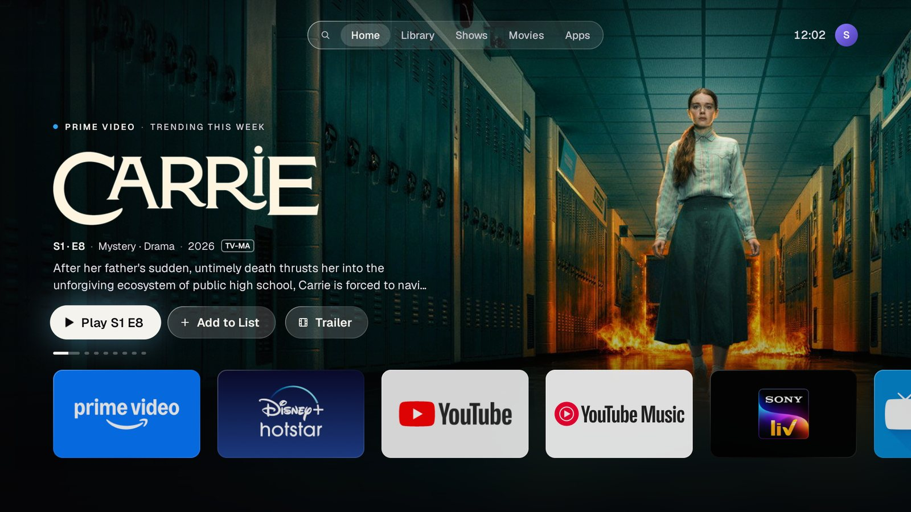
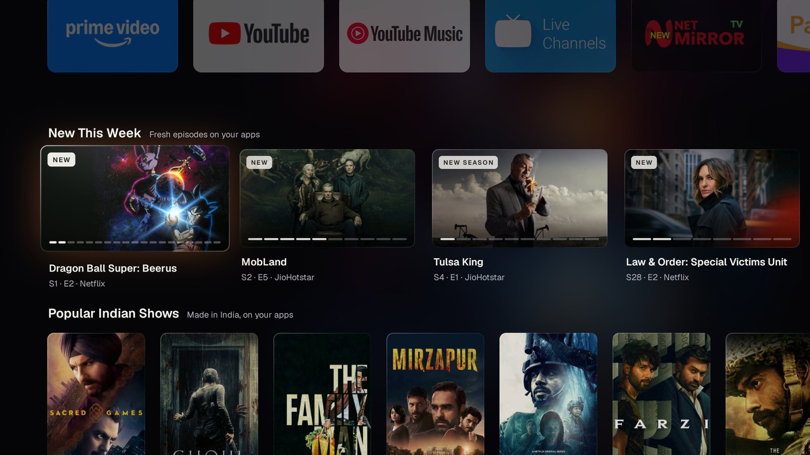
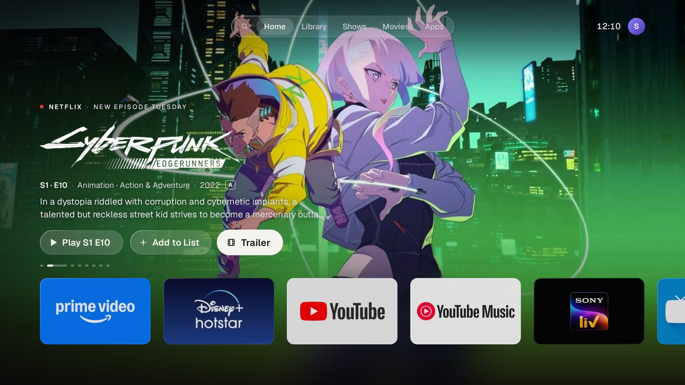
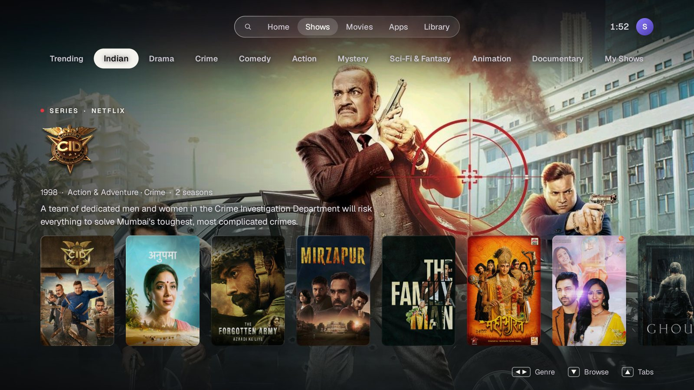
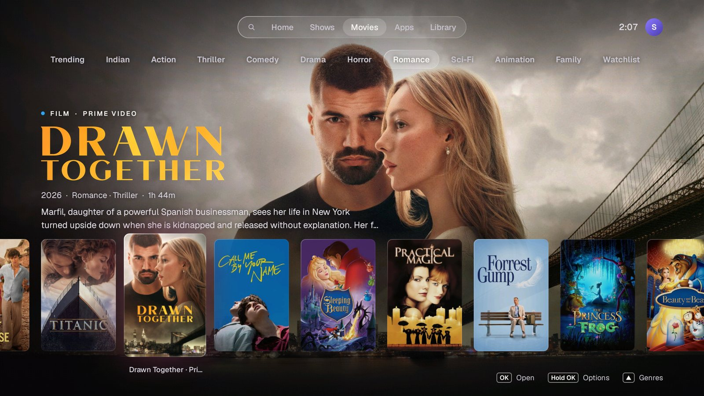
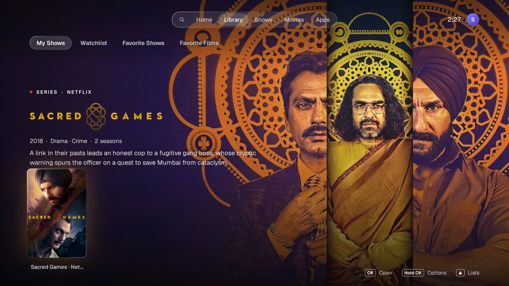
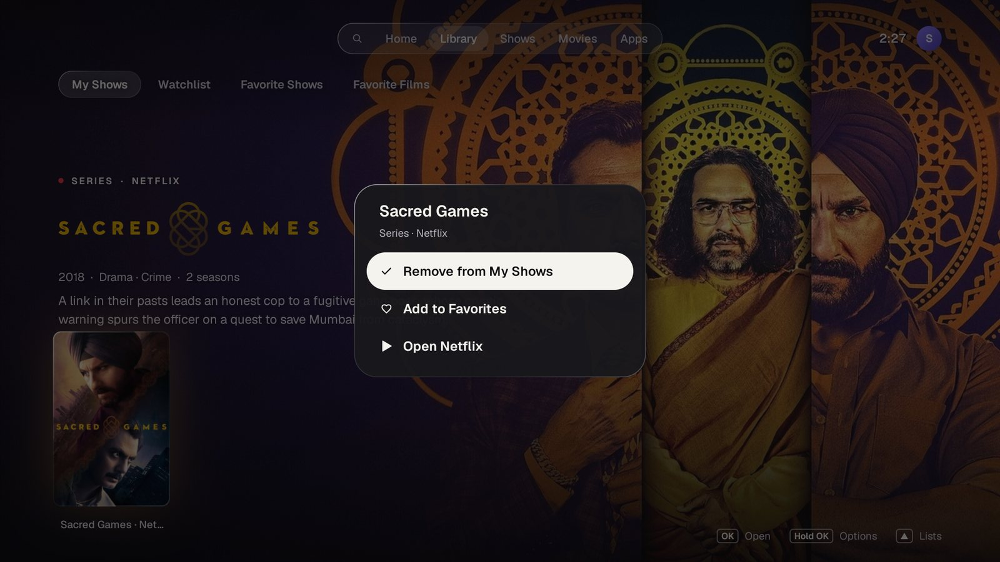
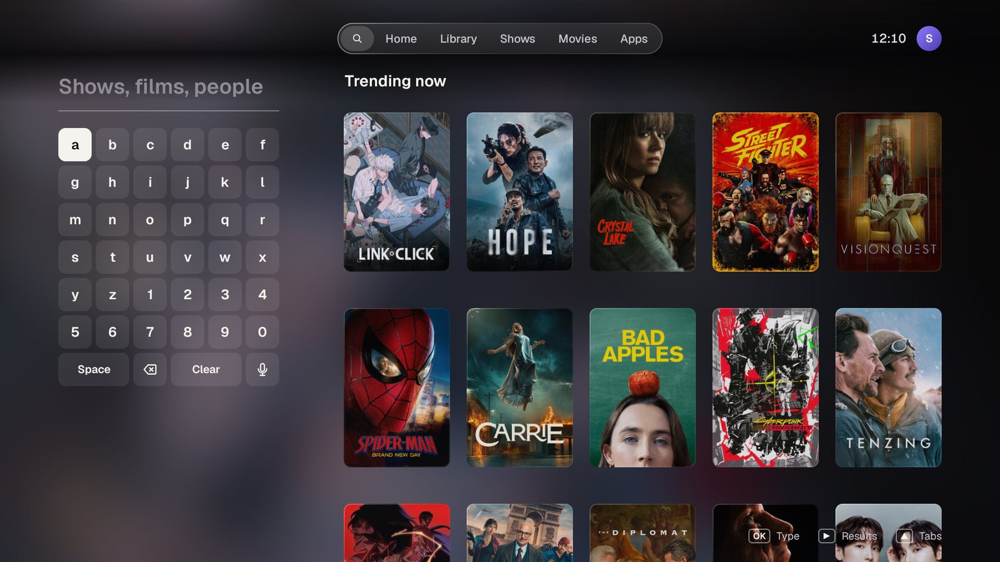
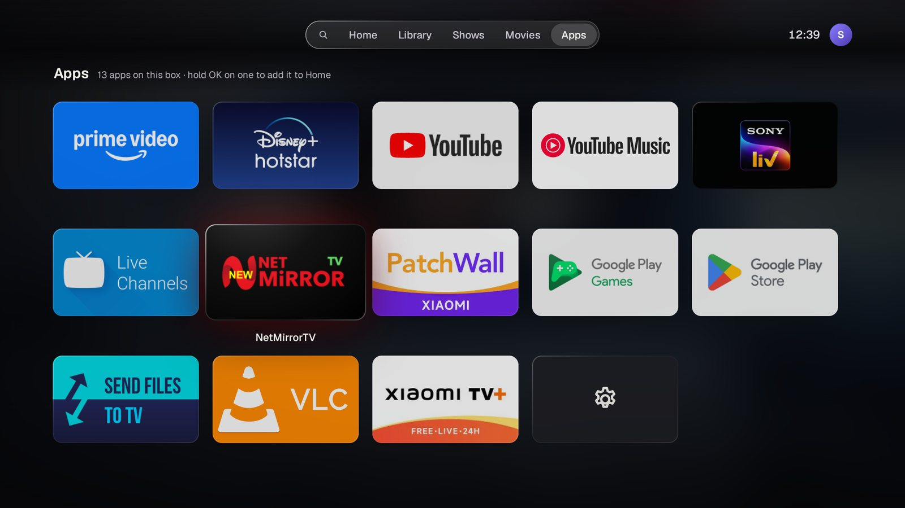

<h1 align="center">Home Launcher</h1>

<p align="center">
  <b>A cinematic home screen for Android TV.</b><br>
  Apple TV's calm, Google TV's immersion and PS5-style browsing, built to stay smooth on a 2 GB Xiaomi Mi Box 4K.
</p>

<p align="center">
  
  
  
  
</p>

<p align="center">
  
</p>

## What it does

- **A banner worth looking at.** Full-bleed art, the show's own title logo, and three buttons: **Play**, **Add to List** and **Trailer**. Left and right walk through the buttons, then on to the next show.
- **Shows and Movies, PS5-style.** Pick a genre (Indian, Drama, Crime, Action and more), and the focused title fills the screen above a single row of posters.
- **Your library.** Sign in to TMDB by scanning a QR code with your phone. Your watchlists and favorites become My Shows, Watchlist and Favorites.
- **Search with your voice.** An on-screen keyboard, plus a mic key that uses the box's own Google speech service. The show you meant comes first.
- **Trailers in place.** Trailers play full-screen inside the launcher, and Back drops you right where you were.
- **Hold OK on anything.** On a show you can add it to a list, favorite it, play its trailer or open its app. On an app you can add it to Home, move it or remove it.
- **Only the apps you want.** The Home row shows your favorite apps, in your order, and the Apps tab has everything else.
- **India first.** Availability comes from TMDB's India listings for Netflix, Prime Video, JioHotstar, SonyLIV, ZEE5 and Apple TV.

## A closer look

### Home

The banner leads with your own shows and fills up with what's trending on your apps. Below it are **Up Next** (new episodes from your shows), **My Shows** and **Favorites**. Suggestion rows always stay underneath, however much you save.





### Shows and Movies

Browsing works like the PS5 home screen. Up from the posters is the genre strip, and the backdrop changes with the focused title.





### Library, menu, Search and Apps

<table>
  <tr>
    <td width="50%"></td>
    <td width="50%"></td>
  </tr>
  <tr>
    <td align="center"><b>Library</b>: everything you've saved on TMDB</td>
    <td align="center"><b>Hold OK</b>: lists, favorites, trailer, open the app</td>
  </tr>
  <tr>
    <td width="50%"></td>
    <td width="50%"></td>
  </tr>
  <tr>
    <td align="center"><b>Search</b>: type or speak; trending until you do</td>
    <td align="center"><b>Apps</b>: hold OK on one to put it on Home</td>
  </tr>
</table>

## On the remote

| Button | What it does |
| --- | --- |
| **D-pad** | Moves focus. On the banner, left and right go across the buttons, then to the previous or next show. |
| **OK** | Opens the app, show or tab in focus. |
| **Hold OK** or **Menu** | Opens the options for that show or app. |
| **Back** | Climbs up: from a row to the banner, from the banner to the tab bar, from another tab to Home. |
| **Home** | Takes you back to the top of Home. |
| **Apps** | Opens the Apps tab (after you turn on the Apps button service; see below). |

## Smooth on a 2 GB box

The Mi Box 4K has a Mali-450 GPU and 2 GB of RAM, so smoothness was designed in from the start rather than patched afterwards. On the box, frames take about 13 ms at the median (60 fps needs under 16.7 ms), including while new posters and data stream in.

- **Plain Android Views and RecyclerView**, with springs from `androidx.dynamicanimation` for focus, lift, tilt and scrolling.
- **No live blur.** The frosted glass is a tiny pre-blurred copy of the art, stretched to full screen.
- **Shading baked into the art.** On Shows and Movies, the gradients behind the words are drawn into the backdrop when it's decoded, which saves about 7 ms of GPU time per frame.
- **Backdrops decoded at 1280×720 off the main thread**, and never more than two held in memory at once.
- **TMDB requests on low-priority background threads**, cached on disk. The first frame draws from the cache, and on Shows and Movies a title's full details load only once focus rests on it.

## Install it

You need a free TMDB API key, the Android SDK and a box with network debugging (ADB) turned on.

1. Get an API key at [themoviedb.org/settings/api](https://www.themoviedb.org/settings/api) and add it to `local.properties` in the project folder. That file is ignored by git, so the key stays out of the repository.
   ```properties
   tmdb.apiKey=YOUR_TMDB_V3_KEY
   ```
2. Build the APK and install it on the box (it's signed with the debug key, which is fine for sideloading):
   ```bash
   ./gradlew assembleRelease
   adb connect <box-ip>:5555
   adb install -r app/build/outputs/apk/release/app-release.apk
   ```
3. **Make it the Home screen.** Android TV's built-in launcher always takes priority over installed ones, so switch it off:
   ```bash
   adb shell pm disable-user --user 0 com.google.android.tvlauncher
   ```
   To go back, run `adb shell pm enable com.google.android.tvlauncher`, or on the TV go to **Settings → Apps → See all apps → Show system apps → Android TV Home → Enable**.
4. **Optional: the remote's Apps button.** Android TV only sends this button to its own launcher. To have it open this launcher's Apps tab instead, go to **Settings → Device Preferences → Accessibility** and turn on **Home Launcher: Apps button**. That service listens for that one button and reads nothing on screen.

## Under the hood

```
app/src/main/java/com/shivansh/mibox/
├── HomeActivity.kt      focus, keys and pages
├── TrailerActivity.kt   full-screen trailers (YouTube's embedded player)
├── AppsKeyService.kt    the remote's Apps button
├── data/                installed apps, favorites, demo content
│   └── tmdb/            TMDB client, catalog, genres, search, lists, QR sign-in
└── ui/                  banner, focus cards, PS5-style pages, keyboard, menu, glass, backdrops
```

- **Kotlin**, `minSdk 28` (Android 9), no Compose and no image-loading library.
- **TMDB v3** for titles, art, logos, trailers, India watch providers and your lists, with **ZXing** for the sign-in QR code.
- Your TMDB session stays on the box. There are no analytics.

## Status

This is a personal project, tested on one device, a Xiaomi Mi Box 4K running Android TV 9. Other Android TV boxes on Android 9 or newer should work, but haven't been tried.

Show and film artwork, logos and trailers belong to their owners and are shown through TMDB. Apple TV, Google TV, PS5 and the streaming services named here are trademarks of their owners; this project isn't affiliated with any of them.

Data and images from [TMDB](https://www.themoviedb.org/). This product uses the TMDB API but is not endorsed or certified by TMDB.
